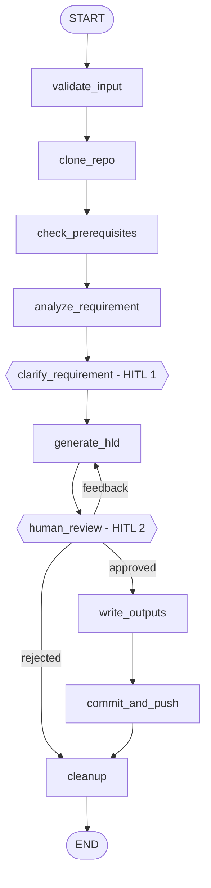

# Architect Agent

The SDLC platform's Architect Agent. For a feature whose requirements are done,
it reads the project repository and writes a high-level design (HLD) into the
repository's `.platform` folder:

```
.platform/{feature_id}/architect/HLD.md                                  # whole feature flow
.platform/{feature_id}/architect/components/{architecture_path}/HLD.md   # one per component
.platform/{feature_id}/architect/status.json
```

It is built on the shared generic agent at the root of this repository
([shipAI_Generic_Agent](https://github.com/shira-ozana/shipAI_Generic_Agent)),
installed as a dependency and used unchanged. The architect is an `AgentDefinition` (its prompt in
`prompts/architect_system.md` plus rules) run by the generic `GenericAgent`,
with two read-only repository tools. Other SDLC agents follow the same pattern
with their own definitions.

```
shipAI_Generic_Agent/
├── src/generic_agent/   shared generic agent (GenericAgent, AgentDefinition, Requirement Agent, ...)
└── agent_architect/     this package (self-contained: own pyproject, tests, docs)
```

## Flow



| Node | What it does |
| --- | --- |
| `validate_input` | `feature_id` follows the Requirement Agent's rule (1-100 letters, digits, `.`, `_`, `-`); `repo_url` must be a github.com URL (normalised like the backend). |
| `clone_repo` | Gets the GitHub credentials from the backend's `repositories` table (decrypted with `ENCRYPTION_KEY`) and makes a shallow clone of the `ShipAi` branch (where the Requirement Agent pushes; `ARCHITECT_SOURCE_BRANCH`) in a temp folder. |
| `check_prerequisites` | Finds the Requirement Agent's output, `.platform/{feature_id}/requierment/requirement.md` (folder spelled as in `generic_agent.agents.requirement`; `requirement/` is accepted too, case-insensitive), and requires its `status.json` to be `completed`. Also reads `clarifications.md` from that folder and `.platform/init/init.md` when present. |
| `analyze_requirement` | Step 1 for the model: extracts FR/NFR, constraints and affected areas from the requirement and the repo, and lists assumptions and clarifying questions. |
| `clarify_requirement` | **HITL 1** (`interrupt()`): shows the analysis and questions; the user answers or corrects (`{"answers": "..."}`, empty = accept the assumptions). |
| `generate_hld` | Step 2 for the model: overall HLD + one HLD per component, using the requirement, the analysis and the user's answers. One corrective retry if the JSON is invalid. |
| `human_review` | **HITL 2** (`interrupt()`): shows the draft; `{"approved": true}`, or `{"approved": false, "feedback": "..."}` for a new revision, or reject. |
| `write_outputs` | The code (not the model) writes the files, so paths are always correct. Replaces earlier architect output for the feature. |
| `commit_and_push` | Commits only `.platform/{feature_id}/architect` and pushes to the same branch (or `ARCHITECT_TARGET_BRANCH`). |
| `cleanup` | Deletes the temporary clone. |

## Skills

The architect's `AgentDefinition` carries these skills (`prompts/skills/`), which
the generic agent renders into every run:

| Skill | Used for |
| --- | --- |
| `requirements-analysis` | Goal, FR/NFR with IDs, constraints, gaps, clarifying questions vs. assumptions. |
| `codebase-discovery` | Reading the repo: stack, `.platform/init` docs, entry points, conventions, what to reuse. |
| `component-decomposition` | Components, responsibilities, new vs. changed, `architecture_path`, dependencies. |
| `interfaces-and-data` | APIs/events, auth, data model, migrations, sensitive data. |
| `quality-risks-decisions` | How NFRs are met, observability, failure handling, ADR-style decisions, risks. |
| `diagrams` | Mermaid component and sequence diagrams. |
| `hld-writing` | HLD section templates and the requirements traceability table. |

To change how the architect thinks, edit these Markdown files; no code change is needed.

Inputs are only `username`, `repo_url` and `feature_id`; the GitHub password or
token never travels in the request. GitHub requires a Personal Access Token
(with `repo` scope) rather than an account password for git operations.

## Setup (Windows)

Requires Python 3.11+ and git. From the repository root:

```powershell
python -m venv .venv
.venv\Scripts\activate
pip install -e .                      # the shared generic agent (repo root)
pip install -e ".\agent_architect[dev]"
cd agent_architect
copy .env.example .env                # then fill in the values
```

`.env` needs the Cursor key/model, plus the same `SUPABASE_URL`,
`SUPABASE_SERVICE_ROLE_KEY` and `ENCRYPTION_KEY` as `sdlc/backend/.env`.

## Run

```powershell
python -m pytest     # offline tests (fake LLM, local git repos)
python -m agent_architect --username ShiraMu --repo-url https://github.com/<owner>/<repo> --feature-id <uuid>
```

The CLI first prints the requirement analysis with its questions and waits for
your answers (Enter accepts the assumptions). Then it prints each HLD draft and
asks: `y` to approve and push, `n` to reject, or type feedback to get a revised
draft. `--auto-approve` skips both human steps.

## Project layout

```
src/agent_architect/
  graph.py            LangGraph graph (nodes above)
  llm.py              Architect AgentDefinition (prompt + rules), run by GenericAgent
  repo_tools.py       Read-only Cursor custom tools over the cloned repo
  design.py           JSON design schema + parsing of the model reply
  platform_paths.py   .platform paths and architecture_path validation
  status.py           status.json (writes architect, reads requirement)
  credentials.py      GitHub credentials from Supabase (Fernet decrypt)
  git_ops.py          clone / commit / push (token never stored in .git/config)
  config.py           Settings from shell or .env
  __main__.py         CLI
  prompts/architect_system.md   role and the two-step flow
  prompts/skills/*.md           architect skills
tests/                Offline tests
```

## Open items

- `architecture_path`: for now the model chooses the component split. When the
  team defines where it comes from (e.g. the Init Agent's output), change
  `generate_hld` / the prompt.
- `REQUIREMENT_DONE_STATUSES` in `status.py` must match the status values the
  Requirements Agent writes.
- The Requirement Agent writes to the `requierment` folder on the `ShipAi`
  branch; the architect follows both. If either changes, update
  `platform_paths.REQUIREMENT_DIR_NAMES` / `ARCHITECT_SOURCE_BRANCH`.
- The package could later move under `src/` like the other agents; it is kept
  self-contained here so it does not change shared files.
- HTTP API for the UI (`POST /api/architect/run`, review endpoint) is not part
  of this step yet.
