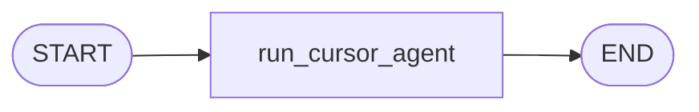

# Architecture

`generic-langgraph-agent` is a small, reusable agent. The Cursor SDK
(`cursor-sdk`, running a *local* agent) produces the answers and LangGraph owns
the graph, state and checkpoints.

## Boundaries

In scope:

- One explicit `StateGraph` over `MessagesState` with a single node.
- A factory, `build_agent(...)`, taking Cursor settings, instructions and a tool
  mapping.
- Cursor configuration from `CURSOR_API_KEY` / `CURSOR_MODEL` (shell or `.env`).
- Three entry points that run the *same* graph: a CLI, LangGraph Studio and a
  local HTTP API.

Out of scope: persistence beyond in-memory checkpointing, cloud agents,
retrieval, multi-agent orchestration, and anything that requires LangSmith for
the CLI or the tests.

## Modules (`src/generic_agent/`)

| Module | Responsibility |
| --- | --- |
| `graph.py` | `build_agent` factory, the `run_cursor_agent` node, prompt rendering (`render_prompt`), default-prompt loading. The only module that calls `Agent.prompt`. |
| `config.py` | `.env` loading, `Settings`, `list_model_ids()` (`Cursor.models.list()`), error translation (`ConfigError`, `CursorRunError`, `describe_error`). |
| `tools.py` | Local Cursor SDK custom tools (`word_count`) and `default_tools()`. |
| `studio.py` | `make_graph()` factory referenced by `langgraph.json`. No checkpointer. |
| `api.py` | FastAPI app (`app`, `create_app`): compiles the graph once at startup with `InMemorySaver` and serves `/api/health` and `/api/chat`. |
| `__main__.py` | CLI (`python -m generic_agent`, `--list-models`): compiles once, runs the chat loop, renders replies and errors. |
| `prompts/default_system.md` | Default agent instructions, shipped as package data. |

Dependency direction: `__main__` / `studio` / `api` -> `config`, `tools`, `graph`;
`graph` -> `config` (for `Settings` and `CursorRunError`).

Per-module guides for changing each piece: [`modules/`](modules/README.md).

## Graph state

`MessagesState`: a single `messages` list with the `add_messages` reducer,
holding only `HumanMessage`s and the `AIMessage`s saved by the node.

- **LangGraph checkpoints are the only conversation memory.** Cursor agents are
  not resumed; each graph run creates a fresh local Cursor agent via
  `Agent.prompt(...)` (create, send, wait, close).
- Instructions are **not** stored in state. They are rendered into each run's
  prompt, so history never accumulates copies.
- The API key and model live in a closure (`Settings`, `SecretStr`), never in
  state or checkpoints, and are not logged.
- Tool calls happen inside Cursor and are not recorded as `ToolMessage`s; only
  the final text is saved.

## Node transition



`run_cursor_agent(state)`:

1. `render_prompt(instructions, messages, max_history_messages)` builds one text
   prompt: `<instructions>`, `<conversation_history>` (the most recent
   `max_history_messages` = 40 earlier human/assistant messages, omitted when
   empty) and `<current_user_message>` (the newest `HumanMessage`).
2. `Agent.prompt(prompt, AgentOptions(...))` runs locally with:
   - `model` and `api_key` from `Settings`;
   - `local.cwd` = a temporary scratch directory deleted after the run;
   - `local.custom_tools` = the registered tools (`None` for a text-only agent);
   - `tools=[]`: Cursor's built-in shell/file tools are disabled by default
     (`build_agent(..., builtin_tools=None)` restores Cursor's default toolset);
   - no `setting_sources`, so no ambient project/user rules are loaded.
3. If `result.status != "finished"` the node raises `CursorRunError` (status,
   run id, error message). Otherwise `result.result` is saved as an `AIMessage`
   with `response_metadata` holding the Cursor run id, agent id and model.

SDK errors that mean the run never started (`CursorAgentError` subclasses)
propagate unchanged.

## Custom tools

`word_count` is a `cursor_sdk.CustomTool` (description, JSON input schema,
`execute(args, context)` returning text) registered through
`LocalAgentOptions.custom_tools`. The SDK serves it from a loopback callback
server in this process while the run executes. `build_agent(..., tools={})`
gives a text-only configuration.

## One graph, three runners

| | CLI | Studio (`langgraph dev`) | HTTP API |
| --- | --- | --- | --- |
| Entry point | `python -m generic_agent` | `langgraph.json` -> `studio.py:make_graph` | `uvicorn generic_agent.api:app` |
| Settings | `config.load_settings()` | `config.load_settings()` | `config.load_settings()` at startup |
| Instructions / tools | default prompt, `default_tools()` | same | same |
| Checkpointer | `InMemorySaver`, one `thread_id` (uuid4) per session | none passed; Agent Server injects its own | one `InMemorySaver`; `threadId` is the `thread_id` |
| Input per turn | only the new `HumanMessage` | the Studio client | only the new `HumanMessage` |

Studio additionally needs a LangSmith login in the browser for the hosted UI;
that is separate from the Cursor key, and the CLI and tests never need it.

## HTTP API

`api.py` serves the graph to local front ends (the separate `sdlc-ui` React
app). Launch (one worker, loopback only):

```bash
pip install -e ".[api]"
python -m uvicorn generic_agent.api:app --host 127.0.0.1 --port 8000
```

Shared contract:

| Endpoint | Request | Success | Errors |
| --- | --- | --- | --- |
| `GET /api/health` | - | `200 {"status":"ok"}`; never touches the graph or Cursor | - |
| `POST /api/chat` | `{"threadId":"<UUID>","message":"<text>"}` | `200 {"threadId":"<same UUID>","reply":"<assistant text>"}` | `422` missing/invalid UUID, non-string or blank message; `409` a run for this thread is in flight; `502` run failed or empty reply |

```bash
curl -s -X POST http://127.0.0.1:8000/api/chat \
  -H 'Content-Type: application/json' \
  -d '{"threadId":"3f2b8c1e-6a4d-4e0b-9d57-1c2a7e5f9b10","message":"Hello"}'
```

Behaviour:

- **Startup**: a FastAPI lifespan loads `Settings` (`CURSOR_API_KEY` /
  `CURSOR_MODEL`, same rules as the CLI; missing config fails startup), calls
  `build_agent(settings, load_default_prompt(), default_tools(),
  checkpointer=InMemorySaver())` once, and closes the SDK's default client on
  shutdown. `create_app(settings)` lets tests inject settings.
- **Per request**: `chat` is a sync route (FastAPI runs it in a worker thread).
  It invokes the graph with only the new `HumanMessage` and
  `{"configurable": {"thread_id": str(threadId)}}`. Different IDs have separate
  checkpoints and histories. `threadId` is parsed as a UUID and echoed in
  canonical lowercase form, so different spellings of one UUID share a thread.
- **Concurrency**: `ThreadGuard` (a lock-protected set) rejects a second request
  for a thread that is still running with `409`, and always releases the thread
  in a `finally`, on success or failure. Different threads run in parallel.
- **Errors**: any exception from the graph (failed run, SDK error) and empty
  reply text become `502 {"detail": "<fixed message>"}`. Raw SDK/run messages are
  never returned; the server logs `describe_error(exc)` (which excludes
  credentials). A failed turn leaves its user message in the thread's
  checkpoint, as in the CLI.
- **CORS**: only `http://localhost:<port>` and `http://127.0.0.1:<port>` origins,
  `GET`/`POST`, `Content-Type` header.
- **Single worker**: the checkpointer and the in-flight guard are in-process
  memory, so run exactly one uvicorn worker; history is lost on restart.

## Configuration and errors

Settings come from non-empty shell variables, falling back to `./.env` in the
working directory. `CURSOR_MODEL` has no default; model IDs come from
`Cursor.models.list()` (`python -m generic_agent --list-models`).

`describe_error` maps failures to actionable text without echoing secrets:
missing configuration, authentication, permission, unknown model, network or
timeout, rate limits, bad requests, other SDK errors and failed runs.

## Tests (`tests/`)

Offline and deterministic: a fake `Agent.prompt` replaces the Cursor SDK (no
network, no bridge process). Covered: graph shape, direct reply, `word_count`
round trip through the registered custom tool, text-only mode, history from
checkpoints within a thread, thread isolation, history trimming, failed runs,
no secrets in state/checkpoints, config loading, `--list-models`, error mapping,
CLI loop, the HTTP API (`tests/test_api.py`: reply, same-thread follow-up
context, thread isolation, validation, `502` safety and guard release, `409`,
CORS), and packaging / `langgraph.json`.
