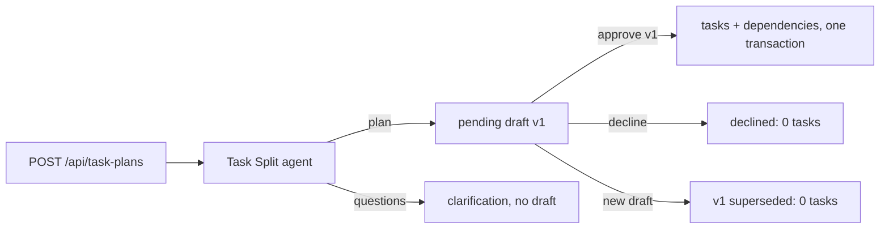

# `task_plans/` - review, approval and task persistence

`src/generic_agent/task_plans/` (`store.py`, `service.py`, `review.py`, `routes.py`)

## Purpose

The backend half of the Task Split flow. It stores the agent's output as a
**draft**, serves a review view grouped by component or service, and writes tasks
only when an authorized user approves the exact version they were shown.

## Invariants (see `store.py`)

- Creating, declining or superseding a draft never writes task rows.
- `approve(plan_id, version, user)`: checks the user is an approver of the plan,
  that this exact version exists and is pending, re-validates the document, then
  writes the status change, groups, tasks and dependencies in **one transaction**.
  Any error rolls all of it back.
- The version is the idempotency key. Repeating approval of an approved version
  returns the stored result (`alreadyApproved: true`) and inserts nothing.
  Tasks are keyed by `(plan_id, plan_version, task_id)`; concurrent retries are
  serialized (`BEGIN IMMEDIATE`).
- A new draft of a plan supersedes its pending drafts. Declined and superseded
  versions can never be approved.
- A plan with an approved version accepts no further drafts. Re-planning after
  approval is not supported yet.
- `create_draft` runs the same validation as the agent guardrails (ownership,
  unique IDs, dependency references, acyclic graph), so an invalid document is
  never stored as a draft, let alone approved.
- Approvers: the creator of the first draft, plus any `approvers` passed then.

## HTTP contract (`routes.py`)

All endpoints need `X-User-Id: <user>` (`401` otherwise). Bodies and errors are
JSON; errors are `{"detail": ...}` with fixed, safe messages.

| Request | Success | Errors |
| --- | --- | --- |
| `POST /api/task-plans` `{"repositoryId", "hlsDocuments":[{"id","title","content"}], "planId"?, "notes"?}` | `200 {"status":"draft","planId","draft":<review>}` or `200 {"status":"clarification","planId","questions":[{"question","whyItMatters","hlsReferences","repoPaths"}]}` | `422` invalid input (blank/duplicate documents, credential in input); `404` unknown repository; `403`/`404`/`409` for an existing plan; `502` the run failed or its reply broke a guardrail (nothing stored) |
| `GET /api/task-plans/{planId}[?version=N]` | `200 <review>` (latest when no version) | `404` (also for other users' plans) |
| `POST /api/task-plans/{planId}/versions/{version}/approve` | `200 {"status":"approved","planId","version","taskCount","dependencyCount","alreadyApproved"}` | `403` not an approver; `404` unknown version; `409` declined or superseded |
| `POST /api/task-plans/{planId}/versions/{version}/decline` | `200 <review>` with `status:"declined"` | `403`, `404`, `409` (already approved or superseded) |
| anything | | `503` when `TASK_SPLIT_REPOSITORIES` is not configured |

Review view (`review.build_review`): `planId`, `version`, `status`
(`pending|approved|declined|superseded`), `repository {id, revision}`,
`hlsReferences`, `groups[]` (each with its `tasks[]`: `id`, `title`, `scope`,
`deliverable`, `acceptanceCriteria`, `hlsReferences`, `repoReferences`, `wave`,
`canStartImmediately`, `dependsOn[{taskId, groupId, crossGroup}]`),
`crossGroupDependencies[]`, `executionWaves[][]` (tasks in a wave can start in
parallel), `discrepancies[]`, `warnings[]`.

Operator setup (also in `.env.example`): `TASK_SPLIT_REPOSITORIES` (JSON of
repository ID to `{path, revision?, allowed_paths?}`) and `TASK_SPLIT_DB`
(default `./task_plans.sqlite3`). Clients select a repository by ID and never
send paths or credentials.

## Handoff: what the UI and deployment still need

This workspace contains the backend. The UI is the separate `sdlc-ui` repo
(`../ShipAI_UI`), which today is chat-only and was **not changed**. To finish the
flow it needs:

1. **Request step.** A form that sends `POST /api/task-plans` with the HLS
   documents and a repository ID (from a list the operator provides). Handle the
   `clarification` response by showing the questions and re-sending with the
   answers in `notes` and the same `planId`.
2. **Review screen.** Render `draft.groups` as sections (one per component or
   service) with their tasks, and show each task's `dependsOn` with the owner
   group; mark `crossGroup: true` entries and list `crossGroupDependencies`.
   Show `executionWaves`, `discrepancies`, `warnings`, `repository.revision` and
   the **version number**.
3. **Approve / Decline buttons** that call `.../versions/{version}/approve|decline`
   with the `version` **from the draft being displayed**, never "latest". Treat a
   `409` as "this version is no longer current": reload with `GET` and show the
   newer draft. Retrying approve after a network error is safe.
4. **Identity.** Send `X-User-Id`. The backend trusts this header, so for any
   shared deployment put an authenticating gateway in front that sets it, and
   replace the header lookup in `routes.current_user` with the real identity.
   The local API has no authentication of its own.
5. **CORS.** Already allows `X-User-Id` from `http://localhost:<port>` /
   `http://127.0.0.1:<port>`.
6. **Existing systems.** If a different database already stores tasks, replace
   `TaskPlanStore._insert_records` with writes to that schema inside the same
   transaction, keeping the version-keyed idempotency, or call it from a
   post-approval hook. The default SQLite tables (`plans`, `plan_drafts`,
   `task_groups`, `tasks`, `task_dependencies`) are self-contained.
7. **Checkouts.** Something must materialise the selected revision as a local
   directory and register it in `TASK_SPLIT_REPOSITORIES`, using whatever
   credentials the host needs outside this process's model input.

## Tests

`tests/test_task_plans.py`: pending/declined/superseded save zero tasks;
approval saves the displayed version with cross-group dependencies; retries and
concurrent retries yield one set; unauthorized users; rollback on failure;
invalid drafts rejected; the HTTP flow end to end.
